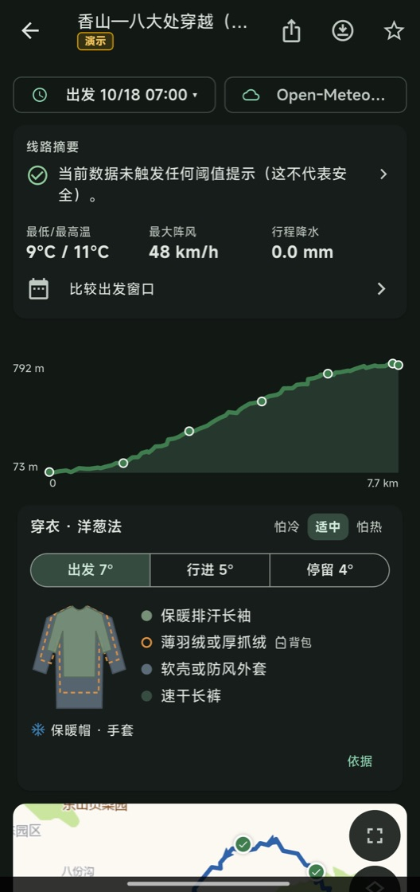
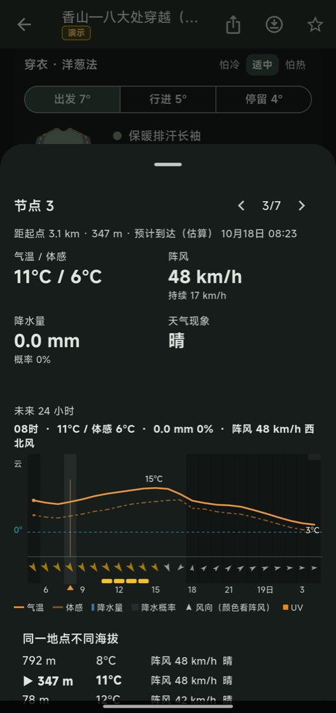
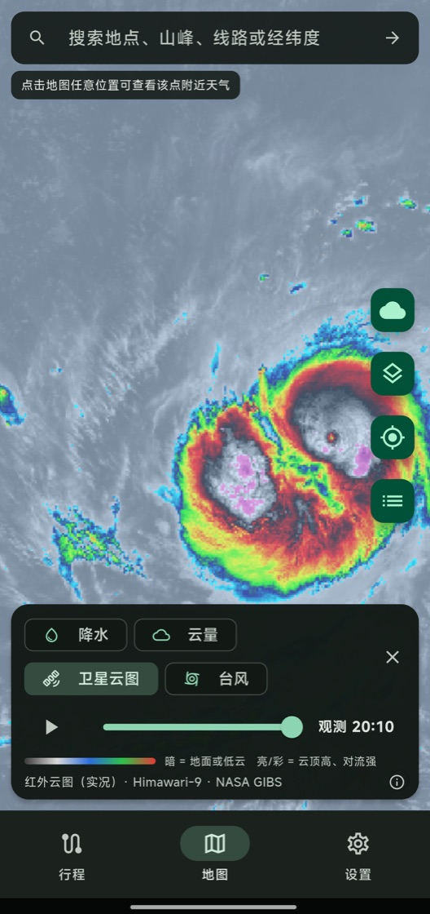
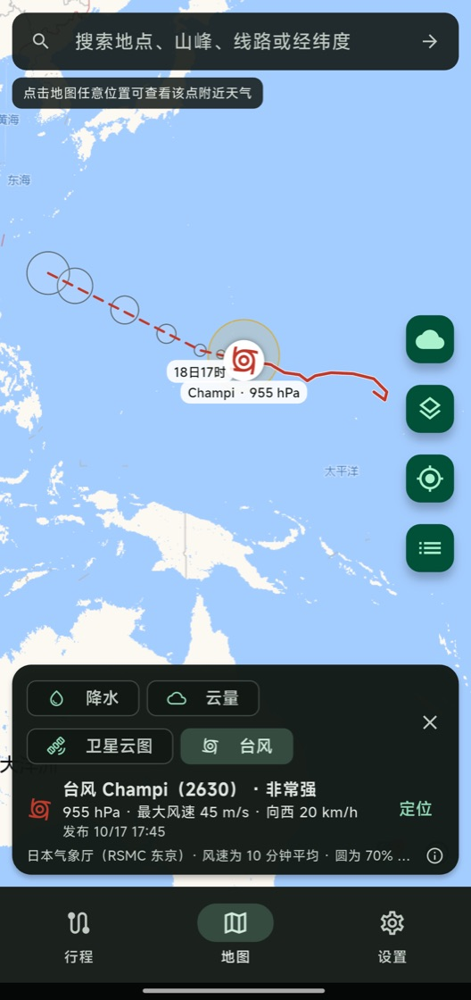
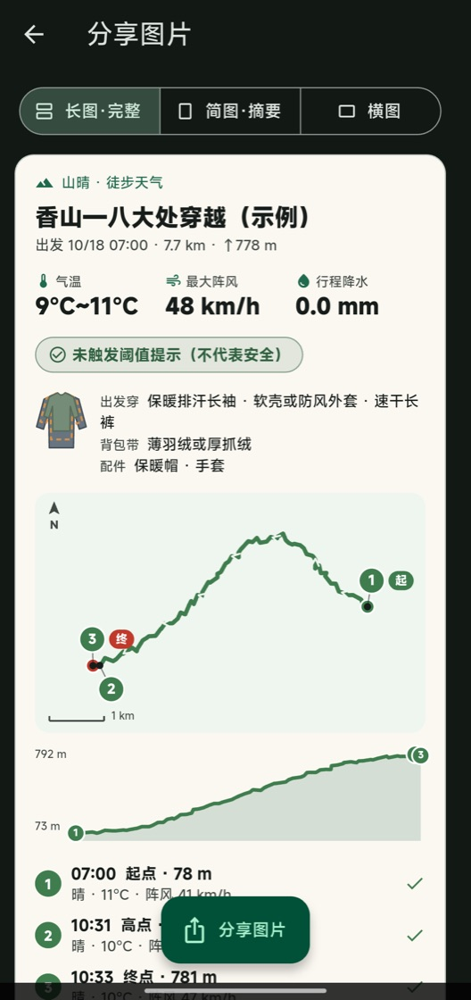

  

<h1 align="center">山晴</h1>

<b>出发前，看懂沿途天气</b>

  给徒步的人用的行前天气工具 · Android / iOS · 公开测试版

  <a href="https://github.com/Panini235/TrailWeather/releases">下载测试版</a> ·
  <a href="docs/user-guide.md">使用文档</a> ·
  <a href="CHANGELOG.md">更新记录</a> ·
  <a href="https://github.com/Panini235/TrailWeather/issues">问题反馈</a>

  
  
  
  
  

## 一条线路，按你走到的时间看天气

导入 GPX / KML / KMZ / GeoJSON（或从两步路、奥维、微信里“用山晴打开”），选好出发时间和配速，
山晴估算你走到每一段的时刻，把那个时刻、那个位置的预报摆在一起：哪一段有风、哪一段要下雨、山顶冷不冷。

- **结论先行**：最要紧的提示放在最上面；海拔剖面上用颜色标出哪一段有风雨。
- **穿衣建议（洋葱法）**：出发、行进、停留三个场景，每层是穿着还是放背包，配件一眼看清；可选“怕冷 / 怕热”。
- **节点详情**：到达时的气温与体感、阵风、降水量与概率；需要留意的信号（紫外线、0℃ 层、低云、湿冷）；
  一张 24 小时气象图把云、温度、降水、风和紫外线叠在一起。
- **天气图**：降水和云量（模式预报，48 小时连续播放）、卫星云图（实况，10 分钟一张）、台风路径。
- **多来源对比**：Open-Meteo、ECMWF、MET Norway，以及自备 Key 的和风天气、meteoblue。
- **出发窗口**：未来几天哪个出发时间更合适，阈值可以自己调。
- **离线行程包**：出发前下载线路和预报，山里没信号也能看。
- **分享图片**：长图 / 简图 / 横图三种版式。

## 只说数据能说的话

- 所有天气都是**预报，不是实测**；提示按公开阈值计算，**不是官方预警，也不是安全评分**。
- 缺失的数据显示“此来源未提供”，从不当成 0；超出预报范围就写“无数据”，不外推。
- 每个数值都标注来源、模式、网格位置和更新时间；不同来源并排比较，不偷偷取平均。
- 不需要注册账号，不内置统计、广告或崩溃上报 SDK，线路和设置只保存在本机。

## 数据来源

| 内容 | 来源 |
| --- | --- |
| 沿途预报（默认） | [Open-Meteo](https://open-meteo.com)（best_match，可切换 ECMWF） |
| 其他预报来源 | MET Norway；和风天气、meteoblue（需自己的 Key） |
| 降水 / 云量天气图 | Open-Meteo 模式预报格点 |
| 卫星云图 | Himawari-9 红外，经 [NASA GIBS](https://gibs.earthdata.nasa.gov) |
| 台风 | 日本气象厅（RSMC 东京） |
| 空气质量 | CAMS，经 Open-Meteo |
| 底图 | 高德、天地图、OpenStreetMap、OpenTopoMap 等 |

各来源的授权、分辨率和限制见 [docs/data-sources.md](docs/data-sources.md)。

## 下载

在 [Releases](https://github.com/Panini235/TrailWeather/releases) 下载：

- **Android**：`.apk` 安装包，允许“安装未知应用”后直接安装。
- **iOS**：未签名的 `.ipa`，需要用爱思助手等工具以自己的 Apple ID 自签后安装，
  步骤见 [使用文档 · iOS 安装](docs/user-guide.md#ios自签安装)。

这是测试版：功能还在调整，已知问题见 [更新记录](CHANGELOG.md)。遇到问题请在
“设置 → 问题反馈”复制诊断信息后到 [Issues](https://github.com/Panini235/TrailWeather/issues) 反馈。

## 文档

- [使用文档](docs/user-guide.md)：安装、导入线路、看懂线路详情、天气图、离线与分享、常见问题
- [开发文档](docs/development.md)：环境、构建、签名、测试与 CI
- [数据来源与授权](docs/data-sources.md) · [数据分级](docs/data-hierarchy.md) · [隐私说明](docs/privacy.md)

## 技术

Flutter（Android / iOS / Web 一套代码），地图为 flutter_map。
